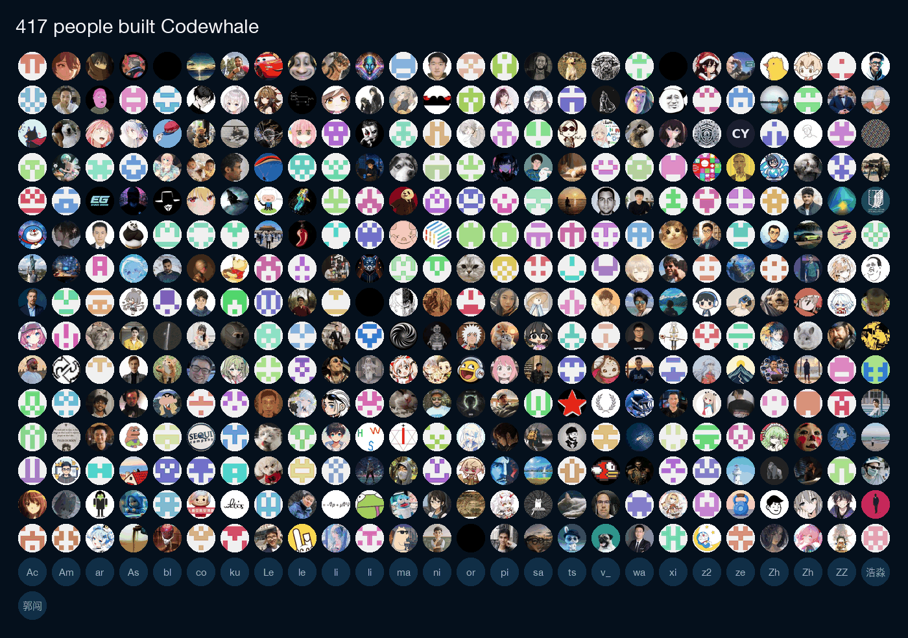

<!-- source: README.md sha256:eefdc9e645b6 -->
<div align="center">

<picture>
  <source media="(prefers-color-scheme: dark)" srcset="brand/wordmark-inverted.svg">
  
</picture>

**Агент для программирования в терминале с открытым исходным кодом, который работает с любой моделью.**

Дайте Codewhale задачу, и он читает репозиторий, редактирует файлы и выполняет
команды, пока задача не будет решена или ему не понадобится ваш ответ. Он
работает с более чем 40 встроенными провайдерами (по умолчанию — DeepSeek V4.1
Flash) и с моделями, запущенными на вашей собственной машине. `/receipts`
перечисляет файлы, которые он изменил, команды, которые он выполнил, и
сделанные им веб- и MCP-вызовы.

[](https://github.com/codewhale-hq/CodeWhale/actions/workflows/ci.yml)
[](https://crates.io/crates/codewhale-cli)
[](https://www.npmjs.com/package/codewhale)
[](LICENSE)
[](https://discord.gg/37gfS3ksug)

[Сайт](https://codewhale.net) · [Документация](docs/README.md) · [Список изменений](CHANGELOG.md) · [Участие в проекте](CONTRIBUTING.md)

[English](README.md) · [简体中文](README.zh-CN.md) · [日本語](README.ja-JP.md) · [Tiếng Việt](README.vi.md) · [Bahasa Indonesia](README.id.md) · [한국어](README.ko-KR.md) · [Español](README.es-419.md) · [Português](README.pt-BR.md) · [Українська](README.uk.md) · [Français](README.fr.md) · [Deutsch](README.de.md) · [繁體中文](README.zh-TW.md) · [हिन्दी](README.hi.md) · [Türkçe](README.tr.md) · [Italiano](README.it.md) · [Polski](README.pl.md) · [العربية](README.ar.md) · [Català](README.ca.md)


<sub>Сборка 0.10.2 для разработки с тестовой моделью, работающей по сценарию, с разрешением Full Access в одноразовой рабочей области. Правка, три теста и проверка субагентом были выполнены по-настоящему.</sub>

</div>

## Установка

macOS и Linux:

```bash
curl -fsSL https://codewhale.net/install.sh | sh
```

Установщик проверяет контрольные суммы и кладёт `codewhale` и его короткий
псевдоним `codew` в `~/.local/bin`. Если после этого оболочка выдаёт
`command not found`, выполните строку для PATH, которую выводит установщик
([подробнее](docs/INSTALL.md#put-it-on-your-path)). Обновление — командой
`codewhale update`. Эти команды устанавливают последний релиз. Страница
описывает ветку `main`, поэтому функция с пометкой версии появится в
соответствующем релизе; что добавляет каждый релиз, смотрите в
[списке изменений](CHANGELOG.md).

<details>
<summary><b>Windows, npm, Cargo и другие способы установки</b></summary>

```bash
winget install HunterBown.CodeWhale  # Windows x64 (or Scoop, or the installer from GitHub Releases)
npm install -g codewhale            # wraps the same release binaries
cargo install codewhale-cli --locked  # crates.io; can trail GitHub Releases
```

Готовые бинарные файлы есть для Linux, macOS и Windows на x64 и arm64. Nix,
Homebrew в Linux, Android/Termux (предварительная версия) и ручная загрузка
описаны в [руководстве по установке](docs/INSTALL.md), а контейнеры — в разделе
[Docker](docs/DOCKER.md). Используйте на одной машине только один способ
установки, иначе в `PATH` окажутся две копии и сработает та, что стоит первой.

</details>

## Быстрый старт

1. Закоммитьте свои изменения или уберите их в stash, затем запустите
   `codewhale` из корня git-репозитория. По умолчанию он применяет там правки
   файлов без запроса и показывает вам diff.
2. Выполните `/provider` (или нажмите `F3`), выберите провайдера, вставьте его
   ключ API и выберите модель. Провайдер по умолчанию — DeepSeek. Если ключа
   нет, выберите вместо этого локальный рантайм. Если ни один провайдер не
   настроен, а Ollama уже обслуживает чат-модель, Codewhale использует её
   автоматически; начиная с 0.10.2 он предлагает её, когда вы отправляете
   первое сообщение.
3. Введите задачу:

```text
Fix the failing tests and explain what changed.
```

Команды только для чтения выполняются сразу. Перед любой другой командой
оболочки Codewhale спрашивает: `y` выполняет её один раз, `a` разрешает
подобные команды до конца разговора, `n` отказывает. `/undo` отменяет ваш
последний запрос и сделанные им изменения в файлах (в 0.10.1 сначала выполните
`/trust on`). `/help` показывает список команд и клавиш.

Для скриптов и CI `codewhale exec` выполняет одну задачу без интерфейса. С
`--auto` он редактирует файлы и выполняет команды оболочки без запроса, поэтому
запускайте его в контейнере или в одноразовой копии репозитория:

```bash
codewhale exec --auto "fix the failing tests and explain what changed"
```

## Режимы и разрешения

Сразу после установки включены режим Work и разрешение Ask.

| | Переключение | Варианты |
| --- | --- | --- |
| Режим | `Tab` (когда поле ввода пустое) или `/mode` | **Plan** читает и ищет, но ничего не меняет. **Work** редактирует файлы и выполняет команды. **Operate** имеет тот же доступ, что и Work, воспринимает ваш запрос как цель и продолжает работу, пока цель не будет проверена или ему не понадобится ваш ответ. |
| Разрешение | `Shift+Tab` | **Ask** применяет правки файлов в вашем репозитории без запроса и спрашивает перед командами оболочки, кроме команд только для чтения. **Auto-Review** позволяет правилам и модели-рецензенту одобрять рутинные вызовы и отклоняет вызовы с высоким риском; чтобы одобрять их самостоятельно, переключитесь на Ask. **Full Access** никогда не спрашивает и отключает песочницу Codewhale; правила репозитория и управляемая политика продолжают действовать. |

Подробности — в [руководстве по режимам и разрешениям](docs/MODES.md).

## Что он умеет

### Скоро в 0.10.2

Эти изменения уже влиты в `main`, но ещё не вошли ни в один опубликованный
релиз; чтобы попробовать их сейчас,
[соберите `main`](docs/INSTALL.md#test-and-contribute-to-current-source).

- `/pet on` превращает терминал в анимированного кита, который показывает, чем
  занят агент, а поле сообщения при этом остаётся доступным. Его 980 частиц
  складываются в название текущего шага на английском, китайском или японском.
- `/workbar terminal` показывает оболочки, которые запускает агент, прямо во
  время их работы. В любую из них можно вводить текст, а `Ctrl+N` открывает
  вашу собственную оболочку (macOS и Linux).
- `/undo` отменяет весь ваш последний запрос за один шаг, включая все
  изменённые им файлы, а `/diff` работает в папках без Git.
- Когда план заканчивается невыполненными шагами, Codewhale спрашивает, начать
  ли Work с Ask или Auto-Review или продолжить планирование.
- `/color` задаёт каждому чату свой цвет поля ввода, который сохраняется вместе
  с сессией.
- `web_search` может использовать новый Search API от DeepSeek: задайте
  `[search] provider = "deepseek"` и укажите ключ DeepSeek.
- Вне Full Access команда `curl` или `wget`, которая отправила бы учётные
  данные, никогда не выполняется без вашего одобрения, а команда, скрывающая
  невидимые символы Unicode, отклоняется. `write` больше не заменяет файл,
  который агент не читал или который изменился после того, как агент его
  прочитал.

### Модели

Встроено более 40 провайдеров, среди них Anthropic, OpenAI, DeepSeek, Google,
Mistral, Moonshot, OpenRouter и xAI. Работает любая OpenAI-совместимая конечная
точка, а также локальные модели через Ollama, vLLM или SGLang. По умолчанию
используется `deepseek-flash` от DeepSeek, который DeepSeek 2026-10-17 перевёл
на DeepSeek-V4.1-Flash-1017; 0.10.1 работает с ним без обновления
([подробнее](docs/PROVIDERS.md#deepseek-v41-flash)).

`/model` переключает модель между ходами, а `/model auto` выбирает модель для
каждого хода (как именно — настраивается через `/router`). `/turn inspect`
показывает, какую модель использовал ход, сколько он стоил и сколько длился.
`codewhale auth chatgpt` позволяет пользоваться подпиской ChatGPT вместо ключа
API (экспериментально). См. [Провайдеры](docs/PROVIDERS.md).

### Квитанции и отмена

`/receipts` (или `codewhale receipts --last` после выхода) перечисляет
изменённые файлы, выполненные команды, веб- и MCP-вызовы, запущенных агентов,
одобрения и тех, кто их дал, а также сбои. `/undo` отменяет ваш последний
запрос; в 0.10.1 для файлов ему нужен `/trust on`, и он откатывает по одному
вызову инструмента за раз. `/restore` откатывает всю рабочую область к более
раннему снимку; поскольку при этом перезаписываются более поздние правки, для
него нужен `/trust on` или Full Access. См. [Квитанции](docs/RECEIPTS.md).

### Долгие задачи

`/goal` задаёт цель, которая сохраняется между ходами. Codewhale может
распределять работу между [субагентами](docs/SUBAGENTS.md), запускать группу
агентов ([Fleet](docs/FLEET.md)) или следовать
[рабочему процессу](docs/WORKFLOW_AUTHORING.md), сохранённому в репозитории.

### Переход с другого агента

Codewhale сам читает `AGENTS.md`. Файлы инструкций, написанные для других
инструментов, например `CLAUDE.md`, `.cursorrules` или
`.github/copilot-instructions.md`, загружаются, только если вы явно включите
это параметром `project_instruction_imports = ["claude"]` (или `"cursor"`,
`"cline"`, `"windsurf"`, `"copilot"`, `"all"`) в конфигурации; см.
[config.example.toml](config.example.toml). Если Codewhale находит такой файл,
но не загружает его, он предупреждает об этом.

`/import-claude` готовит импорт ваших настроек Claude Code и MCP-серверов,
чтобы вы могли его проверить. `/plugin install` принимает плагины Claude Code,
содержащие навыки, команды, профили агентов и MCP-серверы, и отклоняет плагины,
которым нужны хуки или LSP-серверы
([подробнее](docs/CLAUDE_PLUGIN_COMPAT.md)).

### Расширения

Подключайте [MCP-серверы](docs/MCP.md), добавляйте [навыки](docs/SKILLS.md) и
[плагины](docs/PLUGINS.md), запускайте [хуки](docs/HOOKS.md) на события сессии
и инструментов. Code mode (экспериментальный, включён по умолчанию) позволяет
модели написать одну программу `execute_tools`, которая вызывает несколько
инструментов MCP и плагинов; каждый вызов по-прежнему проходит через ваши
правила одобрения и получает свою квитанцию. Входящий в комплект плагин
Computer Use (экспериментальный, только macOS) может наблюдать за другими
приложениями и управлять ими. Он остаётся выключенным, пока вы не проверите
его доступ и не включите его
([руководство](crates/tui/plugins/computer-use/README.md)).

## Способы запуска

| Команда | Что делает |
| --- | --- |
| `codewhale` | Интерактивное терминальное приложение |
| `codewhale exec "…"` | Одна задача без интерфейса. Сам по себе он отвечает, не используя инструменты; `--auto` позволяет ему редактировать файлы и выполнять команды, а `--output-format stream-json` выводит события потоком в формате JSON |
| `codewhale web` | Локальный веб-интерфейс на `127.0.0.1` ([руководство](docs/WEB.md)) |
| `codewhale review --pr N` | Рекомендательный обзор pull request на GitHub. Он ничего не публикует, если вы не добавите `--post`; [GitHub Action](docs/GITHUB_ACTION.md) выполняет тот же обзор в CI |
| `codewhale app-server --http` | [Runtime API](docs/RUNTIME_API.md) — локальный HTTP API для тредов, событий, одобрений и изменений файлов в каждом ходе |
| `codewhale serve --acp` | Agent Client Protocol через stdio для редакторов, например Zed |

Терминальное приложение, `exec`, `web` и Runtime API используют один движок
([архитектура](docs/ARCHITECTURE.md)). Поддерживаемое сообществом
[расширение для VS Code](https://marketplace.visualstudio.com/items?itemName=HengQuWorld.brotherwhale-vscode)
подключается к нему из боковой панели ([исходный код](https://github.com/HengQuWorld/CodeWhale-VSCode)).
Нативное настольное приложение на основе Runtime API находится в разработке;
публичной загрузки для него пока нет.

## Стоимость и аккаунты

Codewhale бесплатен и распространяется под лицензией MIT. Со своим ключом API
вы платите провайдеру напрямую; локальным моделям ключ не нужен. Нижняя строка
и `/cost` показывают, сколько стоила сессия, когда цена известна; неизвестная
цена отображается как неизвестная и никогда — как бесплатная.

Аккаунт не обязателен. Ключи, которые вы добавляете через `/provider`, остаются
на вашей машине.

## Безопасность и конфиденциальность

При разрешениях Ask и Auto-Review команды выполняются в песочнице ОС, если она
есть в системе: Seatbelt в macOS и bubblewrap в Linux, если он установлен. В
Windows песочницы ОС пока нет, а Full Access отключает песочницу. Внутри
песочницы команды оболочки не могут читать хранилища учётных данных, такие как
`~/.ssh`, `~/.aws` и файлы `.env`; начиная с 0.10.2 то же правило
распространяется на терминальные сессии и на большее число файловых
инструментов. `/preview-request` показывает следующий запрос со скрытыми
конфиденциальными данными, не отправляя его.

Телеметрия включена по умолчанию. Она отправляет агрегированные счётчики
(версия и платформа, длительность и итог сессии, какие встроенные провайдеры вы
использовали, счётчики функций и ошибок) вместе со случайным ID установки,
который меняется каждые 90 дней, и никогда не отправляет разговоры, код,
промпты, названия моделей, имена файлов или репозиториев и учётные данные.
`codewhale config set telemetry false` отключает её. При запуске Codewhale
также проверяет на GitHub, не вышел ли новый релиз; чтобы пропустить эту
проверку, задайте `CODEWHALE_NO_UPDATE_CHECK=1`. Подробнее:
[порядок авторизации](docs/AUTHORIZATION_ORDER.md),
[песочница](docs/SANDBOX.md) и [телеметрия](docs/TELEMETRY.md).

## Документация

| С чего начать | Справочник |
| --- | --- |
| [Установка](docs/INSTALL.md) | [Конфигурация](docs/CONFIGURATION.md) |
| [Провайдеры и локальные модели](docs/PROVIDERS.md) | [Архитектура](docs/ARCHITECTURE.md) |
| [Режимы и разрешения](docs/MODES.md) | [Runtime API](docs/RUNTIME_API.md) |
| [Сочетания клавиш](docs/KEYBINDINGS.md) | [Создание плагинов](docs/PLUGIN_AUTHORING.md) |
| [Обзор PR в GitHub](docs/GITHUB_ACTION.md) | [Вся документация](docs/README.md) |

## Сообщество

Если не хватает провайдера или какой-то сценарий неудобен,
[откройте issue](https://github.com/codewhale-hq/CodeWhale/issues/new/choose) или
[отправьте pull request](CONTRIBUTING.md). Авторы сохраняют признание за
принятую работу, а [структура репозитория](CONTRIBUTING.md#project-structure)
показывает, где что находится.

Общайтесь в [Discord](https://discord.gg/37gfS3ksug) или добавьте мейнтейнера,
Хантера, в WeChat (`hunterbown`) и попросите добавить вас в группу
Whale Brothers.

## История и лицензия

Codewhale начинался как `deepseek-tui` и по-прежнему читает конфигурацию и
сессии того проекта. Он развивается независимо и не связан ни с DeepSeek, ни с
другими поставщиками моделей. Спасибо [всем, кто внёс вклад](docs/CONTRIBUTORS.md).

[](docs/CONTRIBUTORS.md#everyone)

[MIT](LICENSE). Код, адаптированный из других проектов с открытым исходным
кодом, перечислен в [уведомлениях о сторонних компонентах](docs/THIRD_PARTY_NOTICES.md).
